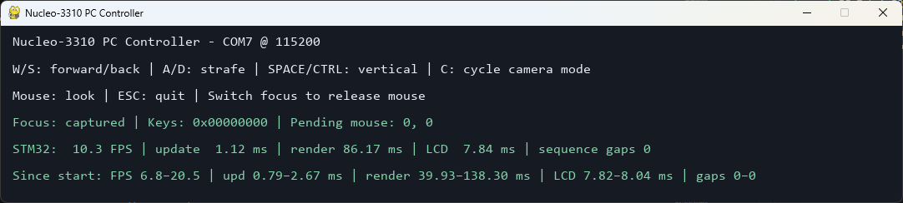

# NUCLEO-3310 — A Tiny 3D City on a Nokia LCD

NUCLEO-3310 is an educational STM32 project that renders and simulates a small 3D city on an 84 × 48 Nokia 3310/5110-compatible LCD.

[](https://youtu.be/kDkRbGgrd6Y)

*Video: hardware setup and camera flythrough through the 3D city.*

## Features

- Custom C 3D engine with perspective projection, near-plane clipping, depth buffering, and monochrome rendering.
- City scene built from reusable meshes, with hierarchical transforms and animated objects.
- Multiple independently moving cars with route, spawn, and intersection behavior.
- Vehicle safety logic for following traffic and maintaining separation.
- Intersection entry coordination with right-hand priority and deadlock recovery.
- Three camera modes: car-follow, free-fly, and a closed demo path.
- PC keyboard and relative-mouse control over the ST-Link Virtual COM Port.
- Batched STM32-to-PC timing telemetry over the same UART.
- Native host tests for portable display, input, camera, scene, modifier, and traffic code.

## Technical highlights

- Scene, modifier, and agent storage uses fixed-capacity data structures. The 84 × 48 float depth buffer occupies 16,128 bytes (15.75 KiB); the monochrome framebuffer adds 504 bytes. These buffers alone use about 16.24 KiB of RAM, before scene state, stack, and HAL data.
- Agent updates use a sensing phase followed by a movement phase, so cars inspect a consistent pre-movement state before changing position. Intersection rules include conflict checks, right-hand priority, and recovery from detected deadlock cycles.
- UART data is encoded field by field rather than by sending C structures. Input frames are ASCII; telemetry is binary with explicit little-endian fields and CRC validation.

## Hardware

- **Board:** NUCLEO-G474RE with STM32G474RE
- **Display:** PCD8544-based 84 × 48 monochrome LCD
- **Display interface:** SPI
- **PC interface:** ST-Link Virtual COM Port on LPUART1, 115200 baud, 8N1

## Build and flash firmware

The firmware is built with CMake and Ninja using the GNU Arm Embedded toolchain (`arm-none-eabi-gcc`). From the project root:

```powershell
cmake --preset Debug
cmake --build --preset Debug
```

To program and debug the board, connect the NUCLEO board through its ST-Link USB connection, open the project in VS Code with the STM32 extension installed, and launch **STM32: Launch ST-Link GDB Server** from Run and Debug. That launch configuration builds the firmware before starting the ST-Link debug session.

## Run the PC controller

The controller is in [`Host/pc_controller`](Host/pc_controller). It is intended for Windows and Python 3.10 or newer; development has been performed with Python 3.14.9. Set `PORT` in `run_controller.py` to the ST-Link COM port, then from PowerShell run:

```powershell
cd Host/pc_controller
py -m venv .venv
.\.venv\Scripts\Activate.ps1
python -m pip install -r requirements.txt
python .\run_controller.py
```

Start the firmware before running the controller. Use **W/A/S/D** to move, **Space/Ctrl** to move vertically, and the mouse to look around in free-fly mode. Press **C** to cycle camera modes:



### Observed telemetry

Measured during several minutes of operation with the demo camera:

| Metric | Observed range |
| --- | ---: |
| FPS | 6.8–20.5 |
| Engine update | 0.79–2.67 ms |
| Rendering | 39.93–138.30 ms |
| LCD transfer | 7.82–8.04 ms |
| Sequence gaps | 0 |

FPS varies with the density of objects visible in the camera frame: busier views require more rendering work. Sequence gaps count missing telemetry sample sequence numbers inferred by the PC; zero means no missing samples were detected during this run. See the [telemetry protocol](Docs/telemetry-protocol.md) for details.

## Host tests

The native test executable covers PCD8544 and display logic, input parsing and state, camera control, scene and modifier behavior, city geometry, and vehicle trajectory, spawning, footprints, and safety logic. Configure, build, and run the tests using the instructions in [`Tests/README.md`](Tests/README.md).

## Documentation

- [3D engine architecture](Docs/3d-engine.md)
- [PC-to-STM32 input protocol](Docs/input-protocol.md)
- [STM32-to-PC telemetry protocol](Docs/telemetry-protocol.md)
- [Host test instructions and suite details](Tests/README.md)
